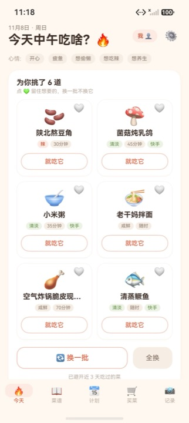
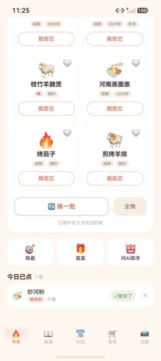
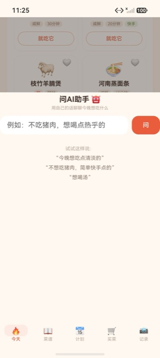
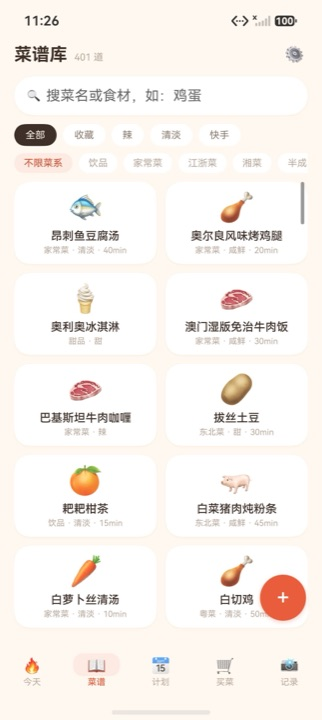
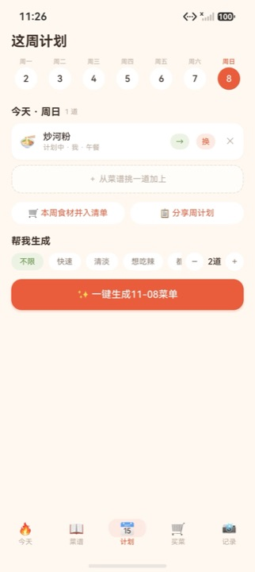
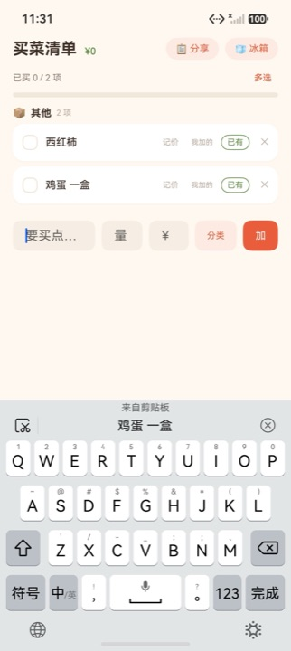
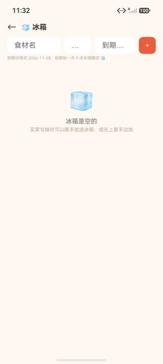
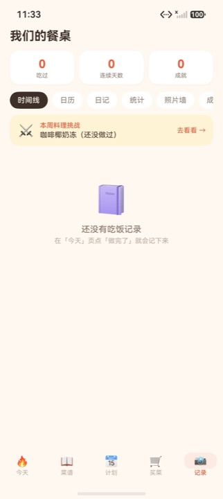
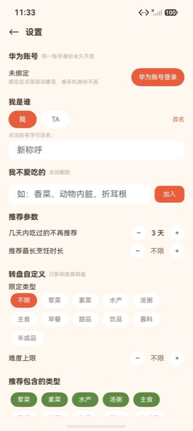

# 今晚吃啥 (WhatToEat)

一款 HarmonyOS 双人点菜助手 App：解决「今晚吃什么」的选择困难。内置菜谱库、随机推荐（转盘/盲盒）、AI 助手（菜谱生成 / 库内推荐 / 清冰箱 / 食材替换）、购物清单与成就系统，支持两台设备间通过自建服务端双向同步，以及对方点菜时的系统级推送提醒（华为 Push Kit）。

## ✨ 功能特性

- 🔀 **智能推荐** — 从 401 道内置菜谱中按口味 / 时长 / 忌口挑 6 道；点 💚 留住想要的，换一批不换它；自动避开近几天吃过的菜
- 🎯 **转盘 / 盲盒** — 选择困难时的随机仪式感，可自定义限定类型与难度
- 🤖 **问AI助手** — 用自己的话聊今晚吃什么：LLM 生成 / 库内推荐 / 小红书灵感检索；未配置 Key 或网络不佳时自动降级本地规则
- 🧊 **清冰箱** — 录入食材与到期日，临期前一天提醒；库里匹配不上就让 AI 现场想一道
- 📅 **这周计划** — 周视图排菜，一键生成整周菜单，食材自动并入买菜清单
- 🛒 **买菜清单** — 点菜自动带出食材，分类 / 记价 / 每周预算，已买顺手入冰箱
- 📸 **餐桌记录** — 时间线 / 日历 / 日记 / 统计 / 照片墙，每周料理挑战与成就系统
- 🔄 **双机同步** — 自建服务端 HttpSync：写后即推、回前台即拉，LWW 合并 + 墓碑删除，断网照常用
- 📲 **对方点菜提醒** — 华为 Push Kit 系统级推送，App 未启动也送达
- 🔐 **隐私优先** — 无第三方统计 SDK，LLM API Key 只保存在自建服务端

## 📸 截图预览

| 智能推荐 | 快捷入口 | 问AI助手 |
|:---:|:---:|:---:|
|  |  |  |
| **菜谱库** | **这周计划** | **买菜清单** |
|  |  |  |
| **清冰箱** | **餐桌记录** | **个性化设置** |
|  |  |  |

## 项目结构

```
├── AppScope/ entry/ hvigor/ ...   # HarmonyOS 客户端（ArkTS）
└── server/                        # 自建同步 + LLM 代理服务端（Go），见 server/README.md
```

- 客户端通过 HTTP 与自建服务端通信：写后即推、回前台即拉、前台轻量轮询；服务端按 `updated_at` 做最后写入优先（LWW）合并，删除走墓碑记录，本地优先、断网照常用。
- LLM 的 API Key 只保存在服务端（`/llm` 代理 + 按天/月限额记账），客户端不持有任何密钥；未配置或网络不佳时自动降级为本地规则逻辑。

## 客户端构建

1. 用 DevEco Studio 打开工程根目录。
2. `File > Project Structure > Signing Configs` 勾选 Automatically generate signature 完成自动签名（本仓库不含签名材料）。
3. `Build > Build Hap(s)/APP(s)` 或命令行：

   ```bash
   hvigorw --mode module -p module=entry@default -p product=default assembleHap --no-daemon
   ```

### 服务端配置（必做）

服务地址与访问令牌不 入库。请创建
`entry/src/main/ets/config/ServerConfig.ets`（该路径已在 `.gitignore` 中）：

```typescript
// 自建服务端连接配置（本地私有文件，已被 .gitignore 排除，切勿提交）
export const SERVER: string = 'http://<你的服务器地址>:8080';
export const TOKEN: string = 'wte_<你的访问令牌>';
```

不创建该文件工程无法编译；不部署服务端也可单机使用（同步与 AI 功能自动降级）。

## 推送（华为 Push Kit）控制台申请

对方点菜的系统级推送走华为 Push Kit v3，除服务端凭据外还需在 [HarmonyOS 开发者中心](https://developer.huawei.com/consumer/cn/hdc-console/) 完成三项一次性配置：

1. **开通推送服务能力**：应用管理 → 你的应用 → 基础信息 → 能力开关，勾选「推送服务」（子项「应用内通话/语音播报消息」本应用用不到，无需申请）。
2. **下载服务账号密钥**：项目设置 → 常规 → 服务帐号密钥 → 创建并下载 JSON（含 `project_id / key_id / private_key / sub_account / token_uri`），上传服务器后以 `WTE_HW_SA_KEY_FILE` 指定路径，见 [server/README.md](server/README.md)。推送走 v3 接口，用该私钥直接签 JWT 鉴权（PS256）。
3. **申请自分类权益（强烈建议）**：推广运营 → 增长运营 → 推送服务 → 申请消息类型，选「即时聊天（IM）」并附消息示例，3 个工作日审核。未申请时通知归入资讯营销类：**不弹横幅、穿戴设备不展示、每设备每日限 2~5 条**；审批通过后服务端设 `WTE_HW_CATEGORY=IM` 即获得完整通知体验。

客户端无需额外申请（`module.json5` 已内置 `client_id` metadata）；调试期服务端保持 `WTE_HW_TEST_MESSAGE=true`（走每日 1000 条测试消息额度），应用上架后改为 `false`。

## 服务端

见 [server/README.md](server/README.md)：Go 编写、SQLite 存储、单一 Bearer Token 鉴权，提供 `/sync`（双机同步）、`/llm`（LLM 代理与限额）、`/register`（推送注册）、`/health` 四个接口。

## 隐私

- 无任何第三方统计/遥测 SDK；数据仅存在本机与你自建的服务端 SQLite 中。
- 推送走华为 Push Kit，仅传输「有人点了菜」这一事件。

## 致谢

- 内置菜谱种子数据整理自开源项目 [HowToCook](https://github.com/Anduin2017/HowToCook) 及下厨房、B 站等公开菜谱来源，仅作学习交流用途。
